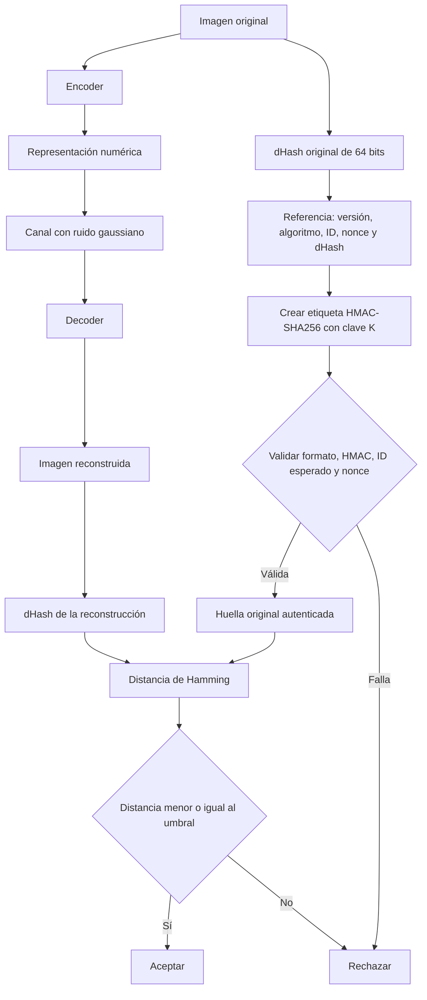

<h1 align="center">PISV: Protocolo de Integridad Semántica Verificable</h1>
<p align="center">
  
  
  
</p>

PISV es un prototipo de transmisión y reconstrucción de imágenes con una red neuronal, acompañado de **autenticación de la referencia mediante HMAC-SHA256** y **comparación perceptual mediante dHash y distancia de Hamming**.

El receptor acepta una reconstrucción cuando la referencia supera la autenticación y los controles de contexto y repetición, y la distancia entre las huellas está dentro del umbral configurado.

**[Abrir la demo interactiva](https://ccdiego918.github.io/PISV-6G-Protocol/)**

El proyecto nace del interés por la seguridad en comunicaciones con inteligencia artificial y futuras redes 6G. La implementación actual utiliza un canal simulado; no implementa una red 6G ni garantiza por sí sola la conservación del significado de cualquier imagen.

## Funcionamiento del protocolo



### 1. Reconstrucción con autoencoder

El encoder transforma una imagen RGB de **32 × 32 píxeles** en una representación de **128 × 4 × 4 valores**. El canal añade ruido gaussiano a esa representación y el decoder produce una reconstrucción RGB de 32 × 32.

| Etapa | Dimensiones, sin contar el lote |
|---|---|
| Imagen original | 3 × 32 × 32 |
| Convolución 1 | 32 × 16 × 16 |
| Convolución 2 | 64 × 8 × 8 |
| Convolución 3 | 128 × 4 × 4 |
| Decoder: tres convoluciones transpuestas | 64 × 8 × 8 → 32 × 16 × 16 → 3 × 32 × 32 |

Se conserva la arquitectura del proyecto original. El entrenamiento utiliza **CIFAR-10**, 50.000 imágenes, 5 épocas, lotes de 128, Adam con tasa de aprendizaje 0,001 y pérdida **MSE** entre la reconstrucción y la imagen original. El ruido de entrenamiento tiene desviación estándar **σ = 0,2**. CIFAR-10 es el conjunto de datos; el modelo es el autoencoder convolucional.

Los pesos se entrenan desde cero y después se cargan para la inferencia. La ejecución experimental revisada y la demo tienen entrenamientos locales separados con esta misma configuración. Las tasas experimentales que se presentan abajo corresponden a la ejecución revisada, no a una evaluación de las diez imágenes de la demo.

### 2. dHash y distancia de Hamming

Para obtener una huella dHash:

1. Convertir la imagen RGB a escala de grises.
2. Redimensionar a **9 columnas × 8 filas**, con interpolación Lanczos.
3. Comparar cada valor con su vecino derecho: escribir `1` si el derecho es mayor y `0` en caso contrario.
4. Concatenar las **8 comparaciones por fila × 8 filas = 64 bits**.

La distancia de Hamming cuenta cuántos bits difieren entre la huella original autenticada y la huella de la reconstrucción:

```python
# Huellas representadas como cadenas hexadecimales de 16 caracteres.
distancia = (int(dhash_original, 16) ^ int(dhash_reconstruido, 16)).bit_count()
aceptacion_perceptual = distancia <= umbral
```

El umbral permite tolerar diferencias de reconstrucción. dHash no es un hash criptográfico y una distancia pequeña no demuestra igualdad de significado. Los **64 bits describen solo la huella**, no el tamaño completo del paquete autenticado.

### 3. Autenticación con HMAC-SHA256

El emisor crea una referencia con estos campos:

| Campo | Función |
|---|---|
| `version` | Versión del formato: `PISV-1.1` |
| `algoritmo` | Algoritmo de huella: `dhash64` |
| `image_id` | Identificador de la imagen o contexto esperado |
| `nonce` | Valor aleatorio de 128 bits para identificar esta transmisión |
| `dhash` | Huella de 64 bits de la imagen original |

Los campos se serializan de manera determinista y se calcula:

```text
etiqueta = HMAC-SHA256(K, referencia_serializada)
```

**HMAC cubre todos los campos, incluido el ID y el nonce.** La clave compartida K no viaja dentro del paquete. HMAC crea una etiqueta de autenticación: no cifra la imagen ni requiere descifrar la referencia.

El receptor verifica, en este orden:

1. Formato, versión y algoritmo admitidos.
2. Etiqueta HMAC, usando su copia de la clave compartida.
3. Coincidencia del ID con el contexto esperado por el receptor.
4. Ausencia de la pareja `(ID, nonce)` en el registro de referencias usadas.
5. Registro del nonce y comparación perceptual mediante dHash/Hamming.

Si falla alguno de los cuatro primeros controles, se rechaza antes de comparar las huellas. Una referencia autenticada consume su nonce aunque después se rechace la reconstrucción por Hamming. La protección contra repetición requiere conservar ese registro.

**Ejemplos:** alterar el dHash manteniendo la etiqueta anterior provoca un fallo de HMAC; repetir un paquete intacto puede conservar un HMAC válido, pero falla el control de repetición.

## Pruebas FAR y FRR

Se distinguen los errores de la decisión perceptual de las pruebas funcionales de autenticación:

- **FRR (False Rejection Rate):** reconstrucciones legítimas rechazadas / total de reconstrucciones legítimas × 100.
- **FAR de sustitución (False Acceptance Rate):** imágenes sustitutas aceptadas / total de sustituciones × 100.

En esta evaluación, «legítima» significa reconstrucción generada por el recorrido normal del modelo. No representa una etiqueta humana de equivalencia semántica. La sustitución utiliza otra imagen de CIFAR-10 y conserva la referencia auténtica de la original: **no es un intento de falsificar HMAC**.

### Condiciones de evaluación

- Entrenamiento: 50.000 imágenes de CIFAR-10 train, 5 épocas, semilla 2026.
- Evaluación: **1.000 originales distintos** de CIFAR-10 test y **1.000 sustitutos distintos**, sin intersección entre ambos grupos.
- Se reservaron otras 1.000 imágenes de test para validación; no se usaron para entrenar los pesos.
- Imágenes RGB de 32 × 32, ruido gaussiano en la representación latente y **σ = 0,2** para el resultado principal.
- Referencias válidas, ID esperado y registro de nonces activo por ejecución.

### Resultado principal: umbral 14

| Caso | Evaluados | Aceptados | Rechazados | Tasa de error |
|---|---:|---:|---:|---:|
| Reconstrucciones legítimas | 1.000 | 996 | 4 | **FRR = 0,4 %** |
| Sustituciones aleatorias | 1.000 | 0 | 1.000 | **FAR = 0,0 % observado** |

La exactitud agregada de ambos grupos equilibrados fue **99,8 %**: `(996 + 1.000) / 2.000`. No es precisión de clasificación de objetos. Cero falsas aceptaciones entre estas 1.000 sustituciones no implica probabilidad nula de error ni resistencia a cualquier ataque.

### Efecto del umbral con las mismas distancias registradas

| Umbral | Legítimas aceptadas | Legítimas rechazadas | FRR | Sustituciones aceptadas | FAR |
|---|---:|---:|---:|---:|---:|
| 2 · estricto | 420/1.000 | 580/1.000 | 58,0 % | 0/1.000 | 0,0 % |
| 10 · intermedio | 977/1.000 | 23/1.000 | 2,3 % | 0/1.000 | 0,0 % |
| 14 · tolerante | 996/1.000 | 4/1.000 | 0,4 % | 0/1.000 | 0,0 % |

Esta tabla se recalculó sobre las distancias del experimento principal; no son tres entrenamientos nuevos. El umbral 10 es el utilizado en el ejemplo del stand. **Las tasas 0,4 % y 99,8 % corresponden al umbral 14**, no al 10. El FAR idéntico en esta muestra no significa que todos los umbrales tengan igual comportamiento ante otros tipos de alteración.

### Efecto del ruido: umbral 14

Se utilizaron los mismos 1.000 originales y realizaciones de ruido normalizado, escaladas por sigma.

| σ | Aceptación legítima | FRR |
|---:|---:|---:|
| 0,1 | 100,0 % | 0,0 % |
| 0,2 | 99,6 % | 0,4 % |
| 0,3 | 99,1 % | 0,9 % |
| 0,4 | 97,5 % | 2,5 % |
| 0,5 | 96,6 % | 3,4 % |
| 0,6 | 95,5 % | 4,5 % |
| 0,7 | 93,9 % | 6,1 % |
| 0,8 | 91,6 % | 8,4 % |
| 0,9 | 89,2 % | 10,8 % |
| 1,0 | 86,6 % | 13,4 % |

Sigma es desviación estándar, no potencia ni SNR en dB. Las sustituciones son independientes del canal y su FAR observado fue 0 % en estas condiciones.

### Otras alteraciones y límites medidos

A σ = 0,2 y umbral 14, se aceptó el **95,1 % de 1.000 imágenes con un parche central 8 × 8 invertido**. Esto muestra una limitación de detección de cambios localizados. No hay anotaciones humanas que permitan equiparar cada aceptación a un error semántico.

En la prueba FGSM con ε = 0,05 y 200 imágenes, a σ = 0,2:

| Umbral | Rechazo de imágenes FGSM | FRR del control legítimo pareado |
|---|---:|---:|
| 14 | 2,5 % | 0,5 % |
| 2 | 86,0 % | 58,0 % |

El umbral estricto aumenta el rechazo de FGSM, pero también rechaza muchas reconstrucciones legítimas. El ataque maximiza el error de reconstrucción MSE; no fue optimizado para evadir dHash.

**Procedencia:** ejecución experimental local revisada, archivada como `PISV_v1_2_validado`. Las cifras se contrastan con `resultados_v1_2/masivo.json`, `ruido.json`, `fgsm.json`, `alteraciones.json` y `distancias_y_decisiones.csv` de esa entrega. El rótulo v1.2 identifica la revisión experimental; el formato autenticado conserva `version = PISV-1.1`.

## Pruebas de autenticación

La ejecución revisada pasó **14 pruebas funcionales, con 0 fallos y 0 errores**, incluyendo:

- Referencia válida y referencia con huella o ID alterados.
- Clave incorrecta, contexto inesperado y formato inválido.
- Repetición de referencias y consumo correcto de nonces.
- Autenticación antes de calcular el hash de reconstrucción.
- Referencia auténtica acompañada de una imagen incorrecta.
- Distancias de Hamming, límites del umbral y aceptación inclusiva (`distancia <= umbral`).

La implementación web también se comprobó con referencias intactas, alteradas y repetidas, claves y contextos incorrectos, formato inválido y comparación con una implementación independiente de HMAC. Estas son pruebas de funcionamiento, no una estimación del FAR criptográfico de HMAC.

## Demo y código

- [Demo pública](https://ccdiego918.github.io/PISV-6G-Protocol/): selección de imagen, ruido, umbral y casos de alteración o repetición de la referencia.
- [Autenticación](docs/auth.mjs): creación y verificación de la referencia HMAC.
- [Huella y Hamming](docs/engine.mjs): pasos de dHash y comparación de bits.
- [Recorrido interactivo](docs/tour.mjs): visualización de cada bloque con datos de la transmisión.
- [Documentación de la demo](docs/README.md): uso, validación y alojamiento.
- [Documento de referencia del proyecto](PISV_Protocol.pdf): contexto del trabajo original. La descripción de la demo actual y las condiciones de las pruebas están en este README.

Las diez imágenes de la galería fueron elegidas por reconocimiento visual, sin filtrar por aceptación del modelo. No son la muestra utilizada para calcular FAR y FRR.

La demo simula emisor y receptor en la misma página. Genera una clave temporal y conserva los nonces en memoria; ambos se reinician al recargar. HMAC protege la referencia, no cifra la imagen ni autentica directamente todos los valores transmitidos por el encoder. El prototipo no implementa distribución de claves ni almacenamiento persistente del estado antirrepetición.

## Autoría

Estudiantes de Ingeniería Civil Telemática de la Universidad Técnica Federico Santa María (UTFSM).

## Presentación:
[Presentación Final](https://docs.google.com/presentation/d/1ckJ2HTE-9C4Bjf45ahLWWliUQ0jkOzy5bwRVudXrqZA/edit?usp=sharing)
## Referencia

Para citar el código, indicar el repositorio y la versión o commit utilizado:

```bibtex
@misc{PISV2026,
  title={Protocolo de Integridad Semántica Verificable (PISV)},
  author={Acevedo, Diego},
  year={2026},
  howpublished={Repositorio de código},
  url={https://github.com/ccdiego918/PISV-6G-Protocol}
}
```

## Licencia

[MIT](LICENSE).
